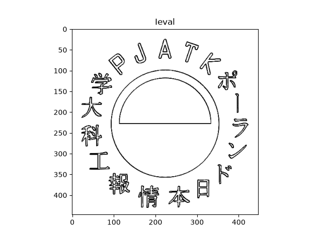

# NAI_fuzzy
**1. HOW TO USE** <br />

Instructions:

```
(.venv) telashar@Holo-PC ~/P/WelcomeScreen (main)> python script.py -h
usage: Image Edge Detector [-h] [-s] [-d] [-g] [-c] [-r] filename

Uses fuzzy logic to detect edges in image

positional arguments:
  filename         path and filename of image to analyze

options:
  -h, --help       show this help message and exit
  -s, --save       save output to file if set true
  -d, --display    display analyzed image
  -g, --greyscale  display greyscale image
  -c, --colour     display colour image
  -r, --gradient   display gradient
```
Example:
```
(.venv) telashar@Holo-PC ~/P/WelcomeScreen (main)> python script.py -d pjatk.png 
```


Original:
